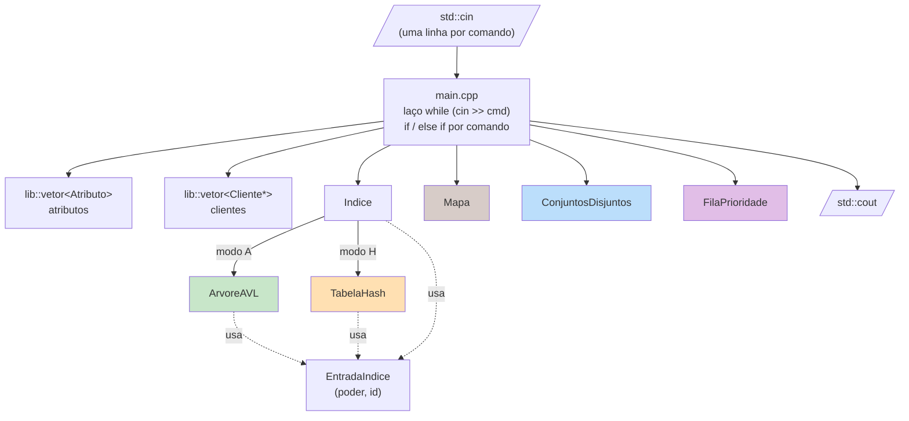
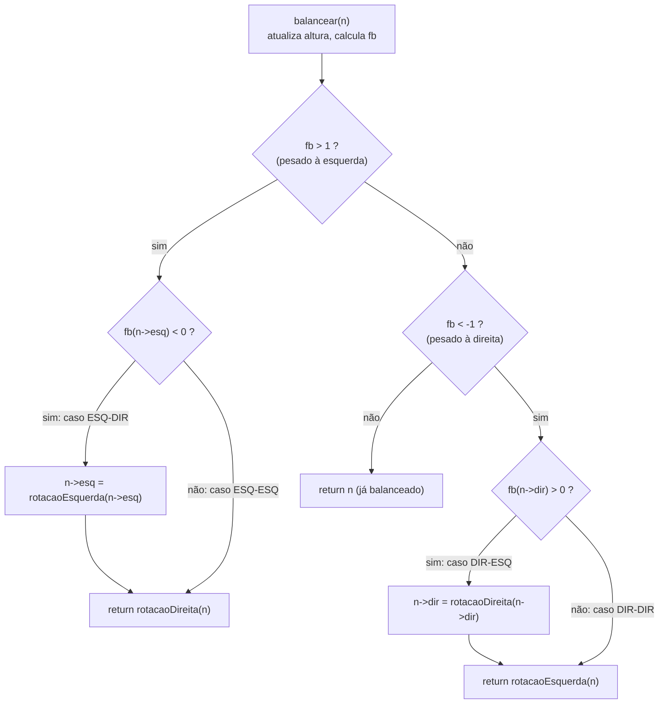

# Guia Visual do Código — TP2 "A Consultoria do Blibblon"

> **Para quem vai gerar o material visual (pessoa ou IA):** este documento descreve um programa em C++11 que implementa, sem usar a biblioteca padrão de estruturas, cinco estruturas de dados: **Árvore AVL**, **Tabela Hash**, **Heap (Fila de Prioridade)**, **Conjuntos Disjuntos (Union-Find)** e **Grafo por Lista de Adjacência**. O objetivo do material visual é fazer o autor **entender e conseguir reescrever** o próprio código numa entrevista.
>
> Cada seção traz:
> - a **ideia** em uma frase;
> - um **diagrama sugerido** (marcado com 🎨);
> - **estados reais** das estruturas, tirados da execução do exemplo oficial (não são ilustrativos: são exatamente o que o código produz);
> - os **nomes das funções** no código, para o visual apontar para elas.
>
> Sugestão de formato: um "mapa geral" no início, uma página/slide por estrutura, e uma linha do tempo do exemplo no final. Use **uma cor fixa por estrutura** em todo o material:
>
> | Estrutura | Cor sugerida |
> |---|---|
> | Índice / AVL | 🟩 verde |
> | Índice / Tabela Hash | 🟧 laranja |
> | Fila de Prioridade (Heap) | 🟪 roxo |
> | Conjuntos Disjuntos | 🟦 azul |
> | Mapa (grafo) | 🟫 marrom |
> | Cliente / Atributo (dados) | ⬜ cinza |

---

## 0. O problema em uma página

Um anão, Blibblon, tem uma consultoria. O programa lê comandos da entrada padrão (`std::cin`), um por linha, e responde cada um na saída padrão. Existem **12 comandos**, que se dividem em **quatro assuntos**:

| Assunto | Comandos | Pergunta respondida | Estrutura que responde |
|---|---|---|---|
| Cadastro | `A` (atributo), `C` (cliente) | — | vetores simples |
| Índice de clientes por **poder** | `E` (modo), `C`, `D` (sair), `BP` (poder exato), `BF` (faixa de poder) | "quem tem poder X?" / "quem tem poder entre X e Y?" | **AVL** (modo A) ou **Hash** (modo H) |
| Mapa de regiões | `R` (região), `T` (rota), `CC` (conectividade) | "dá para chegar de A até B?" | **Union-Find** (e Grafo) |
| Fila de atendimento | `F` (entra na fila), `Z` (atende k) | "quem é o próximo?" | **Heap de máximo** |

**Poder** de um cliente = soma dos valores de todos os atributos da sua build. É calculado uma vez e nunca muda.

🎨 **Diagrama sugerido — "Mapa geral":** quatro colunas (os quatro assuntos), cada uma com seus comandos em cima e a estrutura de dados embaixo, com setas comando → estrutura.

---

## 1. Arquitetura (quem conversa com quem)



**Pontos-chave para o visual:**
- O `main` **só conhece o `Indice`**. Ele nunca sabe se por baixo há uma AVL ou uma Hash. Isso é encapsulamento: o `Indice` é uma "fachada".
- Em cada momento, **só uma** das duas (AVL ou Hash) existe; a outra é `nullptr`.
- Tudo é construído sobre `lib::vetor<T>` (um vetor dinâmico feito à mão em `include/lib.h`, que dobra de capacidade quando enche).

### Arquivos

```
include/                         src/
├── lib.h            (vetor, pilha — base de tudo)
├── Atributo.h       ─────────── Atributo.cpp
├── Cliente.h        ─────────── Cliente.cpp
├── EntradaIndice.h  (struct (poder, id), só header)
├── ArvoreAVL.h      ─────────── ArvoreAVL.cpp
├── TabelaHash.h     ─────────── TabelaHash.cpp
├── Indice.h         ─────────── Indice.cpp
├── FilaPrioridade.h ─────────── FilaPrioridade.cpp
├── ConjuntosDisjuntos.h ─────── ConjuntosDisjuntos.cpp
└── Mapa.h           ─────────── Mapa.cpp
                                 main.cpp
```

---

## 2. O fluxo de cada comando no `main`

🎨 **Diagrama sugerido:** uma tabela-cartão por comando, no formato "entrada → o que o main chama → saída".

| Entrada | O que o `main` faz | Saída |
|---|---|---|
| `E A` | `indice.migrarPara("A")` | `E A` |
| `A Forca` | cria `Atributo(id = atributos.getTamanho(), "Forca")`, adiciona no vetor | `A 0` |
| `C Thorin 2 0 60 2 10` | monta a build `[60, 0, 10]`, cria `new Cliente(...)`, guarda o ponteiro, `indice.inserir(70, 1)` | `C 1 70` |
| `D 3` | `indice.remover(poder, 3)`, `cliente->desativar()` | `D Blibblon 75` |
| `BP 75` | `indice.buscaExata(75, saida)` | `BP 75 cliente_1 0 cliente_2 2 ...` ou `BP 75 VAZIO` |
| `BF 70 80` | `indice.buscaFaixa(70, 80, saida)` | `BF 70 80 cliente_1 1 70 ...` ou `... VAZIO` |
| `R Vilarejo` | `mapa.adicionarRegiao(...)` **e** `conjuntos.criar()` | `R 0` |
| `T 0 1 4` | `mapa.adicionarRota(0, 1, 4)` **e** `conjuntos.unir(0, 1)` | `T Vilarejo Floresta 4` |
| `CC 0 3` | `conjuntos.conectados(0, 3)` | `CC Vilarejo Pico SIM` |
| `F 2 5` | `fila.inserir(2, 5)` | `F <tamanho da fila>` |
| `Z 2` | `n = min(k, tamanho)`; repete `n` vezes `fila.removerMax()` | `Z 2` + linha `atendimento_1 0 9 atendimento_2 1 5` (só se n > 0) |

### Como a build do comando `C` é montada

```
C Thorin 2   0 60   2 10
   nome  k   ↑par1  ↑par2      (k = número de pares atributo-valor)

passo 1: vetor com um zero por atributo cadastrado (3 atributos)
         build = [ 0,  0,  0 ]
                  F   M   Fu
passo 2: par (0, 60)  → build[0] = 60  → [60,  0,  0]
passo 3: par (2, 10)  → build[2] = 10  → [60,  0, 10]
passo 4: poder = 60 + 0 + 10 = 70   (calculado no construtor de Cliente)
```

- "Atributo não informado vale zero" → resolvido pelo passo 1.
- "Atributo repetido: vale o último" → resolvido porque `build[a] = v` **sobrescreve**.

### Padrão de impressão das listas (BP/BF)

Em vez de tratar o último item separado, **cada item começa com um espaço**:

```cpp
std::cout << "BP " << poder;
if (saida.isEmpty()) std::cout << " VAZIO";
for (...) std::cout << " cliente_" << i + 1 << " " << id;
std::cout << "\n";
```

---

## 3. Dados: `Atributo` e `Cliente` ⬜

```
Atributo                      Cliente
┌──────────────┐              ┌───────────────────────────────┐
│ id   : int   │              │ id     : int                  │
│ nome : string│              │ nome   : string               │
└──────────────┘              │ build  : lib::vetor<long long>│ ← build[idAtributo] = valor
                              │ poder  : long long            │ ← soma da build (fixo)
                              │ ativo  : bool                 │ ← false depois do D
                              └───────────────────────────────┘
```

- **Por que `long long`:** valores podem ser negativos e a soma de muitos atributos pode estourar `int`.
- **`getValor(a)`:** se `a` for de um atributo cadastrado **depois** do cliente (fora do tamanho da build), devolve 0.
- **Por que `lib::vetor<Cliente*>` (ponteiros) no `main`:** quando o vetor dobra de capacidade, ele copia todos os elementos. Copiar um ponteiro é barato; copiar um `Cliente` inteiro copiaria a build dele também.
- **O id é a posição no vetor:** o cliente com id 3 está em `clientes.getById(3)`. Acesso O(1). Clientes que saem (`D`) **não** são apagados do vetor (os ids não podem mudar); só ficam `ativo = false` e saem do índice.

---

## 4. O Índice (a "fachada") 🟩🟧

```
                  ┌──────────────────────────────┐
   main  ───────▶ │ Indice                       │
                  │  modo   = "A" ou "H"         │
                  │  arvore ──▶ ArvoreAVL  ou nullptr
                  │  tabela ──▶ TabelaHash ou nullptr
                  └──────────────────────────────┘
   Interface: inserir, remover, buscaExata, buscaFaixa, migrarPara
```

Cada método só repassa a chamada:

```cpp
void Indice::inserir(long long poder, int id) {
    if (arvore != nullptr) arvore->inserir(poder, id);
    else if (tabela != nullptr) tabela->inserir(poder, id);
}
```

### Migração (`E`) — `Indice::migrarPara`

🎨 **Diagrama sugerido:** três quadros lado a lado: "listar tudo" → "construir a nova" → "apagar a antiga".

```
  ANTES (modo A)            PASSO 1: listar            PASSO 2: inserir na nova       DEPOIS (modo H)
  ┌─────────┐               todos = [(70,1),           ┌──────────────────┐         arvore = nullptr
  │  AVL    │   listarTodos     (75,0),                │ TabelaHash nova  │         tabela ──▶ Hash
  │ (3 nós) │ ────────────▶     (75,2)]  ────────────▶ │ inserir × 3      │
  └─────────┘                                          └──────────────────┘
                                         PASSO 3: delete arvore
```

- Se o modo pedido **já é** o atual → não faz nada.
- No **primeiro** `E` não há estrutura antiga: a lista sai vazia e só a nova é criada.
- Custo: listar O(n) + inserir tudo: O(n log n) para a AVL, O(n) em média para a Hash.

---

## 5. Árvore AVL (modo A) 🟩

**Ideia:** árvore binária de busca em que, **em todo nó**, as alturas das subárvores esquerda e direita diferem de no máximo 1. Isso garante altura ≈ log₂(n) e, portanto, operações em O(log n).

### 5.1 O nó e a chave

```
NoAVL
┌──────────────────────┐
│ poder  : long long   │ ┐
│ id     : int         │ ┘ chave = (poder, id)
│ altura : int         │   folha = 1, nullptr = 0
│ esq, dir : NoAVL*    │
└──────────────────────┘
```

**Por que a chave é o par (poder, id) e não só o poder:** vários clientes podem ter o mesmo poder. Com o par, toda chave é única **e** a ordem da árvore fica "por poder, desempate por id", que é **exatamente** a ordem que o `BF` pede. O `BP` vira um caso particular: a faixa `[p, p]`.

Comparação (`comparar`): primeiro o poder; se empatar, o id.

### 5.2 Estado REAL da árvore no exemplo oficial

Inserções: `(75,0)` Grunilda, `(70,1)` Thorin, `(75,2)` Legolas, `(75,3)` Blibblon. **Nenhuma rotação foi necessária.**

```
Depois dos 4 C:                         Depois do D 3 (remove (75,3)):

          (75,0) h=3                              (75,0) h=2
          /        \                              /        \
   (70,1) h=1    (75,2) h=2                (70,1) h=1    (75,2) h=1
                       \
                     (75,3) h=1
```

Observe: `(70,1)` fica à **esquerda** de `(75,0)` porque 70 < 75, mesmo tendo id maior. `(75,2)` fica à **direita** de `(75,0)` porque o poder empata e 2 > 0.

### 5.3 Fator de balanceamento

```
fb(n) = altura(n->esq) − altura(n->dir)

fb = +2  → pesado à esquerda  → precisa girar para a direita
fb = −2  → pesado à direita   → precisa girar para a esquerda
fb ∈ {−1, 0, +1} → ok
```

### 5.4 As duas rotações

🎨 **Diagrama sugerido:** animação ou par antes/depois, com A, B, C como triângulos (subárvores) e x, y como círculos. Destacar que **B muda de pai**.

```
rotacaoDireita(y)                         rotacaoEsquerda(x)

        y                x                   x                    y
       / \              / \                 / \                  / \
      x   C    ==>     A   y               A   y      ==>       x   C
     / \                  / \                 / \              / \
    A   B                B   C               B   C            A   B
```

Código (3 trocas de ponteiro + 2 atualizações de altura):

```cpp
NoAVL* ArvoreAVL::rotacaoDireita(NoAVL* y) {
    NoAVL* x = y->esq;
    y->esq = x->dir;      // B passa a ser filho esquerdo de y
    x->dir = y;           // y desce para a direita de x
    atualizarAltura(y);   // y agora está embaixo: atualiza primeiro
    atualizarAltura(x);
    return x;             // x é a nova raiz desta subárvore
}
```

### 5.5 Os 4 casos de desbalanceamento — `balancear(n)`



| Caso | Formato | Correção |
|---|---|---|
| ESQ-ESQ | `/` (linha para a esquerda) | 1 rotação à direita |
| DIR-DIR | `\` (linha para a direita) | 1 rotação à esquerda |
| ESQ-DIR | `<` (zigue-zague) | esquerda no filho, depois direita no nó |
| DIR-ESQ | `>` (zague-zigue) | direita no filho, depois esquerda no nó |

### 5.6 Exemplo REAL com rotações (inserindo 10, 20, 30, 25, 27)

🎨 **Diagrama sugerido:** sequência de 5 quadros, destacando em vermelho o nó com |fb| = 2.

```
ins 10        ins 20         ins 30 → fb(10) = −2, caso DIR-DIR
                                       rotacaoEsquerda(10)
  10            10              10                    20
                  \               \                  /  \
                   20              20       ==>    10    30
                                     \
                                      30

ins 25 (sem rotação)          ins 27 → fb(30) = +2, e fb(25) = −1 → caso ESQ-DIR
                                rotacaoEsquerda(25), depois rotacaoDireita(30)
      20                         20                   20                     20
     /  \                       /  \                 /  \                   /  \
   10    30                   10    30             10    30               10    27
        /                          /                     /                     /  \
      25                         25           ==>      27          ==>       25    30
                                   \                  /
                                    27              25
```

### 5.7 Inserção — `inserirRec`

Recursiva. Desce comparando como numa árvore de busca comum, cria a folha, e **na volta da recursão** chama `balancear` em cada nó do caminho.

```
inserirRec(n, chave):
    se n == nullptr: cria nó novo e retorna
    se chave < n: n->esq = inserirRec(n->esq, chave)
    se chave > n: n->dir = inserirRec(n->dir, chave)
    retorna balancear(n)     ← o rebalanceamento acontece "subindo"
```

🎨 **Diagrama sugerido:** seta descendo (busca) em azul, seta subindo (balancear) em verde.

### 5.8 Remoção — `removerRec` (o caso mais pedido em entrevista)

Três casos para o nó a remover:

```
  Caso 0 filhos          Caso 1 filho             Caso 2 filhos
  (folha)                                          → o SUCESSOR ocupa o lugar

    [X]  → some           [X]       →   B           [X]                 [S]
                            \                      /   \               /   \
                             B                    A     D      →      A     D'
                                                       / \                 / \
                                                     [S]  E               .   E
                                                  (menor da direita)
```

- **0 ou 1 filho:** o filho (ou `nullptr`) sobe para o lugar do nó, que é apagado.
- **2 filhos:** `desligarMinimo(n->dir, sucessor)` **tira** o menor nó da subárvore direita (sem apagá-lo, já rebalanceando o caminho) e devolve a nova subárvore direita. O sucessor então **assume o lugar** de `n`: recebe `n->esq` e a nova direita. `n` é apagado. **Não há cópia de dados**, só troca de ponteiros.
- Depois de qualquer caso, `balancear` na volta da recursão. Diferente da inserção, na remoção **podem ocorrer rotações em vários níveis** até a raiz.

### 5.9 Busca por faixa — `faixaRec` (o BF)

Percurso **em ordem** (esquerda → nó → direita) com **poda**:

```cpp
if (n->poder >= min) faixaRec(n->esq, ...);   // à esquerda só há menores: só vale descer se ainda pode haver ≥ min
if (min <= n->poder && n->poder <= max) adiciona(n);
if (n->poder <= max) faixaRec(n->dir, ...);   // à direita só há maiores: só vale descer se ainda pode haver ≤ max
```

**Traço REAL de `BF 70 80` na árvore do exemplo:**

```
          (75,0)  ③
          /     \
   (70,1) ②    (75,2) ④
                   \
                 (75,3) ⑤

Ordem de visita/saída: (70,1) → (75,0) → (75,2) → (75,3)
Saída: BF 70 80 cliente_1 1 70 cliente_2 0 75 cliente_3 2 75 cliente_4 3 75
```

🎨 **Diagrama sugerido:** a árvore com galhos "podados" em cinza (para uma faixa estreita numa árvore grande), mostrando que só um "corredor" da árvore é visitado. Custo O(log n + m), m = tamanho da resposta.

---

## 6. Tabela Hash (modo H) 🟧

**Ideia:** um vetor de "baldes". Uma função transforma o poder num número de balde. Achar um poder = ir direto ao balde dele: O(1) em média.

### 6.1 Estrutura

```
TabelaHash
  baldes : NoHash**      (vetor de ponteiros, tamanho numBaldes = 2^bitsBaldes, começa com 16)
  numChaves              (poderes distintos guardados)
  numElementos           (clientes guardados)

NoHash  (uma entrada = um poder distinto)
┌────────────────────────┐
│ poder : long long      │
│ ids   : lib::vetor<int>│  ← todos os clientes com esse poder, em ordem crescente
│ prox  : NoHash*        │  ← próxima entrada no MESMO balde (encadeamento)
└────────────────────────┘
```

### 6.2 Estado REAL no exemplo oficial (depois do `E H`)

Clientes ativos: (70,1), (75,0), (75,2). Com 16 baldes, o código calcula 70 → balde **4** e 75 → balde **5**.

```
baldes (16)
 [0]  ∅
 [1]  ∅
 [2]  ∅
 [3]  ∅
 [4]  ──▶ { poder 70 | ids [1]    } ──▶ ∅
 [5]  ──▶ { poder 75 | ids [0, 2] } ──▶ ∅
 [6]  ∅
 ...
 [15] ∅
```

### 6.3 Colisão e encadeamento separado

**Colisão** = dois poderes diferentes no mesmo balde. Valores REAIS: com 16 baldes, os poderes **7, 20 e 75** caem todos no balde 5. A entrada nova entra **no início** da lista; se foram inseridos na ordem 75, 20, 7, o balde fica:

```
 [5]  ──▶ {poder 7 | ids[..]} ──▶ {poder 20 | ids[..]} ──▶ {poder 75 | ids[0,2]} ──▶ ∅
```

**Por que encadeamento (e não endereçamento aberto):** a remoção (`D`) é frequente. No encadeamento, remover é só tirar o nó da lista. No endereçamento aberto, apagar quebraria a sequência de busca de outras chaves e exigiria "lápides".

### 6.4 Função de espalhamento — `posicao(poder)` (hash multiplicativo de Knuth)

```cpp
unsigned long long x = (unsigned long long) poder;          // ① negativo vira inteiro grande válido
unsigned long long h = x * 11400714819323198485ull;         // ② multiplica por 2^64 / φ (razão áurea)
return (int)(h >> (64 - bitsBaldes));                       // ③ os bits MAIS ALTOS escolhem o balde
```

🎨 **Diagrama sugerido:** um "liquidificador": entrada 70, 71, 72… (números vizinhos) → saída em baldes embaralhados.

Valores REAIS com 16 baldes (poderes consecutivos se espalham):

| poder | 70 | 71 | 72 | 73 | 74 | 75 | 76 | 77 | 78 | 79 | 80 |
|---|---|---|---|---|---|---|---|---|---|---|---|
| balde | 4 | 14 | 7 | 1 | 11 | 5 | 15 | 9 | 3 | 13 | 7 |

- ① **Poder negativo:** `-1` vira `18446744073709551615`. Cada poder distinto continua distinto, e o índice nunca é negativo (ao contrário de `poder % M`, que em C++ daria negativo).
- ② **Por que multiplicar:** poderes costumam ser parecidos (70, 75, 80). Um `poder % 16` simples os colocaria em baldes vizinhos. A multiplicação pela razão áurea espalha até números consecutivos.
- ③ **Por que os bits altos:** são os mais "misturados" pela multiplicação, e como o número de baldes é potência de 2, basta um deslocamento (sem divisão).

### 6.5 Fator de carga e rehash — `rehash()`

```
fator de carga α = numChaves / numBaldes     (tamanho médio de cada lista)

Regra: se α > 0,75  (no código: 4 * numChaves > 3 * numBaldes)  →  rehash
```

- **O que o rehash faz:** dobra o número de baldes (16 → 32 → 64 …), aumenta `bitsBaldes` em 1 e **religa** cada nó no seu balde novo. Os nós não são recriados; só os ponteiros mudam.
- **Quando acontece:** com 16 baldes, ao inserir o **13º** poder distinto (4 × 13 = 52 > 48).
- **Custo:** um rehash custa O(n), mas como só acontece a cada dobra, o custo **amortizado** por inserção continua O(1). É o mesmo argumento do `dobrar_capacidade` do `lib::vetor`.

🎨 **Diagrama sugerido:** tabela de 16 baldes com listas compridas → seta "rehash" → tabela de 32 baldes com listas curtas.

### 6.6 As operações

| Operação | Passos | Custo médio |
|---|---|---|
| `inserir(p, id)` | acha o balde → procura a entrada `p` na lista → se não existe, cria no início (se o balde já tinha algo, conta uma colisão) → insere `id` na lista de ids mantendo a ordem (procura de trás para frente; como ids chegam crescentes, quase sempre para na hora) → verifica o fator de carga | O(1) |
| `remover(p, id)` | acha o balde e a entrada → acha o `id` por **busca binária** na lista de ids → remove → se a lista de ids ficou vazia, tira a entrada do balde e a apaga | O(1) + O(k)* |
| `buscaExata(p)` (BP) | acha a entrada e copia os ids (já ordenados) | O(1) |
| `buscaFaixa(min, max)` (BF) | ver abaixo | O(M + n + d log d) |

\* k = quantos clientes têm aquele mesmo poder (o deslocamento no vetor de ids).

### 6.7 BF na Hash — o ponto fraco

A hash **não guarda ordem**. Para responder uma faixa:

```
① varre TODOS os baldes, separando as entradas com min ≤ poder ≤ max
     selecionados = [ {75|0,2}, {70|1} ]          (ordem dos baldes, bagunçada)
② merge sort das entradas por poder
     selecionados = [ {70|1}, {75|0,2} ]
③ expande cada entrada (os ids já estão em ordem)
     saída = (70,1), (75,0), (75,2)
```

Ordena **entradas** (um poder distinto cada), não clientes: se 1000 clientes têm poder 75, ordena 1 entrada, não 1000.

🎨 **Diagrama sugerido:** comparação lado a lado "BF na AVL" (caminho estreito na árvore) vs "BF na Hash" (varredura da tabela inteira + funil de ordenação).

---

## 7. AVL × Hash — quem ganha o quê 🟩 vs 🟧

| Operação | AVL | Hash | Vencedora esperada |
|---|---|---|---|
| Inserir (`C`) | O(log n) + rotações | O(1) médio | 🟧 Hash |
| Remover (`D`) | O(log n), rotações podem ir até a raiz | O(1) médio | 🟧 Hash |
| Poder exato (`BP`) | O(log n + m) | O(1 + m) | 🟧 Hash |
| Faixa (`BF`) | O(log n + m) | O(M + n + d log d) | 🟩 **AVL** |
| Migração para cá | O(n log n) | O(n) | 🟧 Hash |
| Memória por cliente | 1 nó (poder, id, altura, 2 ponteiros) | 1 int na lista de ids (+ 1 entrada por poder distinto) | 🟧 Hash |

n = clientes, m = tamanho da resposta, M = número de baldes, d = poderes distintos na faixa.

### Localidade de referência (cache)

| Acesso | O que acontece na memória | Efeito no cache |
|---|---|---|
| Descer a AVL | salto de ponteiro a cada nível; nós espalhados pela memória | ruim: cada salto pode ser um "cache miss" |
| Achar o balde na Hash | 1 acesso a um vetor contíguo, mas em posição "aleatória" | 1 possível miss, depois a lista (curta) |
| BF na AVL | visita nós logicamente vizinhos em sequência | razoável |
| BF na Hash | varre o vetor de baldes do início ao fim (sequencial) + segue ponteiros | bom na varredura, ruim nos nós |
| `lib::vetor` / heap | tudo contíguo | ótimo |

🎨 **Diagrama sugerido:** a memória como uma régua horizontal; na AVL, setas pulando para longe; no vetor, setas curtas e contíguas.

---

## 8. Fila de Prioridade (Heap de máximo) 🟪

**Ideia:** uma árvore binária "completa" guardada **dentro de um vetor**, em que todo pai vem antes dos filhos. O próximo a ser atendido está sempre na posição 0.

### 8.1 Árvore ⇄ vetor

```
índice:   0     1     2     3     4     5
vetor:  [ A  |  B  |  C  |  D  |  E  |  F ]

árvore:          A(0)
               /      \
           B(1)        C(2)
          /    \       /
       D(3)   E(4)   F(5)

pai(i) = (i − 1) / 2      esq(i) = 2i + 1      dir(i) = 2i + 2
```

🎨 **Diagrama sugerido:** a árvore em cima e o vetor embaixo, com linhas ligando cada nó à sua célula.

### 8.2 Critério de ordem — `vemAntes(a, b)`

```cpp
if (a.prioridade != b.prioridade) return a.prioridade > b.prioridade;   // maior prioridade primeiro
return a.idCliente < b.idCliente;                                       // empate: menor id primeiro
```

**Todo** o critério está nesta função. Mudar a regra de desempate = mudar só aqui.

### 8.3 As operações

- **`inserir`:** coloca no fim do vetor → **`subir`**: enquanto o item vier antes do pai, troca com ele. O(log n).
- **`removerMax`:** guarda a raiz → move o **último** para a raiz → remove a última posição → **`descer`**: enquanto algum filho vier antes, troca com o **melhor** dos dois filhos. O(log n).

### 8.4 Traço REAL do exemplo oficial

Itens no formato `(prioridade, id)`.

```
F 2 5   inserir (5,2)          vetor: [(5,2)]                          → F 1

F 0 9   inserir (9,0)          vetor: [(5,2), (9,0)]
        subir: (9,0) vem antes do pai (5,2)? SIM → troca
                               vetor: [(9,0), (5,2)]                   → F 2

F 1 5   inserir (5,1)          vetor: [(9,0), (5,2), (5,1)]
        subir: (5,1) vem antes do pai (9,0)? NÃO → para                → F 3

                (9,0)
               /     \
           (5,2)     (5,1)

Z 2
  removerMax #1: sai (9,0); último (5,1) vai para a raiz
                               vetor: [(5,1), (5,2)]
        descer: (5,2) vem antes de (5,1)? prioridades iguais, id 2 > 1 → NÃO → para
        → atendimento_1 0 9
  removerMax #2: sai (5,1); último (5,2) vai para a raiz
                               vetor: [(5,2)]
        → atendimento_2 1 5
  Saída: "Z 2" e "atendimento_1 0 9 atendimento_2 1 5"

Z 5     só há 1 na fila → n = min(5, 1) = 1
  removerMax: sai (5,2)        vetor: []
  Saída: "Z 1" e "atendimento_1 2 5"   (os outros 4 atendimentos são perdidos)
```

🎨 **Diagrama sugerido:** uma tira de quadrinhos com a árvore + vetor a cada passo, com setas curvas mostrando as trocas.

- **Cliente repetido na fila:** cada `F` cria um item separado, então ele é atendido uma vez por entrada.

---

## 9. Conjuntos Disjuntos (Union-Find) 🟦

**Ideia:** cada grupo de regiões conectadas é uma árvore. Cada região aponta para um "pai"; a **raiz** é o representante do grupo. Duas regiões estão conectadas ⇔ têm a mesma raiz.

### 9.1 Estrutura

```
pai  : lib::vetor<int>    pai[x] = pai de x  (raiz: pai[x] == x)
rank : lib::vetor<int>    estimativa da altura da árvore cuja raiz é x
```

| Operação | Chamada por | O que faz |
|---|---|---|
| `criar()` | cada `R` | `pai[x] = x`, `rank[x] = 0` (grupo sozinho) |
| `encontrar(x)` | `unir`, `conectados` | sobe até a raiz **e comprime o caminho** |
| `unir(a, b)` | cada `T` | acha as duas raízes; a de **menor rank** vira filha da outra |
| `conectados(a, b)` | `CC` | `encontrar(a) == encontrar(b)` |

### 9.2 Traço REAL do exemplo oficial

Regiões: 0 Vilarejo, 1 Floresta, 2 Caverna, 3 Pico, 4 IlhaPerdida.

```
R × 5      pai  = [0, 1, 2, 3, 4]    rank = [0, 0, 0, 0, 0]
           (0) (1) (2) (3) (4)        ← cinco grupos sozinhos

T 0 1      raízes 0 e 1, ranks iguais → pai[1] = 0, rank[0] = 1
           pai  = [0, 0, 2, 3, 4]    rank = [1, 0, 0, 0, 0]
              0         (2) (3) (4)
              |
              1

T 1 2      encontrar(1) = 0, encontrar(2) = 2; rank[0] = 1 > rank[2] = 0 → pai[2] = 0
           pai  = [0, 0, 0, 3, 4]
               0           (3) (4)
              / \
             1   2

T 0 2      encontrar(0) = 0 = encontrar(2) → já estão juntos, nada muda (unir devolve false)

T 2 3      encontrar(2) = 0, encontrar(3) = 3; rank[0] = 1 > 0 → pai[3] = 0
           pai  = [0, 0, 0, 0, 4]    rank = [1, 0, 0, 0, 0]
                0             (4)
              / | \
             1  2  3

CC 0 3     encontrar(0) = 0, encontrar(3) = 0 → iguais → "CC Vilarejo Pico SIM"
CC 0 4     encontrar(0) = 0, encontrar(4) = 4 → diferentes → "CC Vilarejo IlhaPerdida NAO"
```

### 9.3 As duas otimizações

🎨 **Diagrama sugerido:** antes/depois de cada uma.

**Compressão de caminho** (no `encontrar`, em duas passadas). Exemplo ilustrativo de uma cadeia longa:

```
1ª passada: sobe até a raiz           2ª passada: todos do caminho apontam direto para a raiz

   0  ← raiz                                    0
   |                                         /  |  \
   1                                        1   2   3
   |
   2
   |
   3  ← encontrar(3)
```

**União por rank** (no `unir`): a árvore mais baixa é pendurada na mais alta, para a altura não crescer à toa. Rank só aumenta quando as duas têm o mesmo rank.

Com as duas: custo amortizado O(α(n)), em que α é a inversa da função de Ackermann (≤ 4 para qualquer n realista, ou seja, praticamente constante).

- **Limitação:** só **junta**, nunca separa. Funciona porque o problema não tem comando para remover rotas.

---

## 10. Mapa (grafo por lista de adjacência) 🟫

### 10.1 Estrutura

```
nomes : lib::vetor<string>                 nomes[id] = nome da região
adj   : lib::vetor< lib::vetor<Rota>* >    adj[id]   = rotas que SAEM de id
Rota  = { destino, custo }
```

Cada `T u v c` grava **duas** rotas (mão dupla): `u → v` e `v → u`.

### 10.2 Estado REAL do exemplo oficial

```
          4             3
 Vilarejo ─── Floresta ─── Caverna ─── Pico           IlhaPerdida
   (0)          (1)          (2)   2    (3)              (4)
    └──────────── 9 ──────────┘

adj[0] Vilarejo    : → (1, 4)  → (2, 9)
adj[1] Floresta    : → (0, 4)  → (2, 3)
adj[2] Caverna     : → (1, 3)  → (0, 9)  → (3, 2)
adj[3] Pico        : → (2, 2)
adj[4] IlhaPerdida : (vazia)
```

- **Por que lista e não matriz:** a matriz gasta memória regiões², e a lista gasta regiões + rotas. Mapas costumam ter poucas rotas por região.

### 10.3 A BFS — `alcancavelBFS` (só para o experimento)

O `CC` da saída é respondido pelo **Union-Find**. A BFS existe para **comparar** as duas formas (experimento 4 do enunciado).

**Traço REAL de 0 → 3:**

```
fila: [0]                 visitados: {0}
tira 0 (visita 1): não é 3 → enfileira 1, 2          fila: [1, 2]
tira 1 (visita 2): vizinhos 0 e 2 já marcados        fila: [2]
tira 2 (visita 3): vizinhos 1, 0 marcados; enfileira 3  fila: [3]
tira 3 (visita 4): é o destino → SIM                 (4 regiões visitadas)
```

**Truques para não alocar memória a cada consulta:**
- **Fila:** um vetor fixo do próprio Mapa, do tamanho do número de regiões (cada região entra no máximo uma vez), com índices `inicio` e `fim`.
- **Marcação por rodada:** cada BFS faz `rodadaBFS++`. "Visitado" significa `marca[v] == rodadaBFS`. Não é preciso zerar o vetor de marcas.

### 10.4 Union-Find × BFS

| | Union-Find | BFS |
|---|---|---|
| Custo por `T` (construir) | ~O(1) (um `unir`) | O(1) (só grava a rota) |
| Custo por `CC` (consultar) | ~O(1) | O(regiões + rotas) no pior caso |
| Responde "por onde"? | não | poderia (não é pedido) |
| Aceita remover rota? | não | sim |

🎨 **Diagrama sugerido:** um "relógio de custo": Union-Find paga um pouquinho a cada `T` e responde instantâneo; BFS não paga nada antes e paga caro a cada `CC`.

---

## 11. Linha do tempo completa do exemplo oficial

🎨 **Diagrama sugerido:** uma linha do tempo horizontal com 31 comandos, e embaixo quatro "trilhas" (Índice, Fila, Union-Find, Clientes) mostrando o estado mudando.

| # | Entrada | Saída | O que mudou |
|---|---|---|---|
| 1 | `E A` | `E A` | Índice cria uma AVL vazia |
| 2–4 | `A Forca` / `A Magia` / `A Furtividade` | `A 0` / `A 1` / `A 2` | 3 atributos |
| 5 | `C Grunilda 2 0 40 1 35` | `C 0 75` | build [40,35,0]; AVL += (75,0) |
| 6 | `C Thorin 2 0 60 2 10` | `C 1 70` | build [60,0,10]; AVL += (70,1) |
| 7 | `C Legolas 3 0 20 1 20 2 35` | `C 2 75` | build [20,20,35]; AVL += (75,2) |
| 8 | `C Blibblon 1 1 75` | `C 3 75` | build [0,75,0]; AVL += (75,3) |
| 9–13 | `R ...` × 5 | `R 0` … `R 4` | 5 regiões, 5 grupos sozinhos |
| 14–17 | `T ...` × 4 | `T Vilarejo Floresta 4` … | grafo montado; grupos {0,1,2,3} e {4} |
| 18 | `BP 75` | `BP 75 cliente_1 0 cliente_2 2 cliente_3 3` | — |
| 19 | `BF 70 80` | `BF 70 80 cliente_1 1 70 cliente_2 0 75 cliente_3 2 75 cliente_4 3 75` | — (Thorin primeiro: menor poder) |
| 20 | `CC 0 3` | `CC Vilarejo Pico SIM` | — |
| 21 | `CC 0 4` | `CC Vilarejo IlhaPerdida NAO` | — |
| 22–24 | `F 2 5` / `F 0 9` / `F 1 5` | `F 1` / `F 2` / `F 3` | heap [(9,0),(5,2),(5,1)] |
| 25 | `Z 2` | `Z 2` + `atendimento_1 0 9 atendimento_2 1 5` | heap [(5,2)] |
| 26 | `D 3` | `D Blibblon 75` | AVL −= (75,3); Blibblon inativo |
| 27 | `BP 75` | `BP 75 cliente_1 0 cliente_2 2` | — |
| 28 | `BF 70 80` | `BF 70 80 cliente_1 1 70 cliente_2 0 75 cliente_3 2 75` | — |
| 29 | `E H` | `E H` | **migração**: AVL → Hash (balde 4: 70→[1]; balde 5: 75→[0,2]) |
| 30 | `BF 0 200` | `BF 0 200 cliente_1 1 70 cliente_2 0 75 cliente_3 2 75` | — (mesma resposta: só a estrutura mudou) |
| 31 | `Z 5` | `Z 1` + `atendimento_1 2 5` | heap vazio |

---

## 12. Resumo de complexidade

| Estrutura | Operação | Tempo | Espaço |
|---|---|---|---|
| AVL | inserir / remover / BP | O(log n) | O(n) |
| AVL | BF | O(log n + m) | |
| Hash | inserir / remover / BP | O(1) médio, O(n) pior caso | O(n + M) |
| Hash | BF | O(M + n + d log d) | |
| Hash | rehash | O(n), amortizado O(1) por inserção | |
| Índice | migração | O(n log n) para AVL, O(n) para Hash | O(n) temporário |
| Heap | inserir / removerMax | O(log n) | O(n) |
| Union-Find | criar / unir / encontrar | O(α(n)) amortizado ≈ O(1) | O(regiões) |
| Mapa | adicionar região / rota | O(1) amortizado | O(regiões + rotas) |
| Mapa | BFS | O(regiões + rotas) | O(regiões) |

---

## 13. Instrumentação (para os experimentos)

Cada estrutura **conta o próprio trabalho** e expõe getters + `resetarEstatisticas()`.

| Estrutura | Contadores |
|---|---|
| ArvoreAVL | `getNumComparacoes`, `getNumRotacoes`, `getAltura`, `getMemoriaBytes`, `verificar()` (confere ordem e balanceamento) |
| TabelaHash | `getNumComparacoes`, `getNumColisoes`, `getNumRehash`, `getNumBaldes`, `getNumChaves`, `getMaiorBalde`, `getMemoriaBytes` |
| FilaPrioridade | `getNumComparacoes`, `getNumTrocas`, `getMemoriaBytes` |
| ConjuntosDisjuntos | `getNumBuscas`, `getNumPassos`, `getNumUnioes`, `getMemoriaBytes` |
| Mapa | `getUltimasVisitadas`, `getTotalVisitadas`, `getNumConsultasBFS`, `getMemoriaBytes` |
| Indice | `getArvore()` / `getTabela()` dão acesso às estruturas acima |

---

## 14. Cartões de estudo para a entrevista

🎨 **Diagrama sugerido:** cartões "frente / verso" (pergunta na frente, resposta + função no verso).

| Pergunta provável | Resposta curta | Onde está |
|---|---|---|
| Por que a chave da AVL é (poder, id)? | Chaves únicas e ordem igual à do BF; BP vira faixa [p, p] | `ArvoreAVL::comparar` |
| Quando ocorre rotação dupla? | Quando o filho pende para o lado oposto ao do nó (zigue-zague) | `ArvoreAVL::balancear` |
| Como remove um nó com 2 filhos? | Desliga o sucessor (menor da direita) e o coloca no lugar | `removerRec`, `desligarMinimo` |
| Por que a remoção pode girar mais que a inserção? | A inserção para de desbalancear após 1 correção; a remoção pode reduzir a altura e desbalancear ancestrais até a raiz | `removerRec` |
| Como a hash trata poder negativo? | Converte para `unsigned long long` antes de multiplicar | `TabelaHash::posicao` |
| O que é colisão e como é tratada? | Dois poderes no mesmo balde; encadeamento separado (lista) | `TabelaHash::inserir` |
| Quando ocorre rehash? | Quando 4·chaves > 3·baldes (α > 0,75); dobra os baldes | `TabelaHash::rehash` |
| Por que o BF na hash é caro? | A hash não guarda ordem: varre tudo e ordena (merge sort) | `TabelaHash::buscaFaixa` |
| Como funciona a migração? | Lista tudo, cria a outra estrutura, insere tudo, apaga a antiga | `Indice::migrarPara` |
| Como o heap desempata? | Maior prioridade; empate → menor id | `FilaPrioridade::vemAntes` |
| O que `subir` e `descer` fazem? | Restauram a regra "pai vem antes dos filhos" após inserir/remover | `FilaPrioridade::subir/descer` |
| O que é compressão de caminho? | Após achar a raiz, faz todos do caminho apontarem direto para ela | `ConjuntosDisjuntos::encontrar` |
| Por que union-find e não BFS no CC? | ~O(1) por consulta vs O(V+E); não há remoção de rotas | `main` (CC), `Mapa::alcancavelBFS` |
| Por que `Cliente*` no vetor? | Ao dobrar, o vetor copia elementos; ponteiro é barato | `main.cpp` |
| Por que `long long`? | Valores negativos e somas grandes | `Cliente`, `ItemFila`, `Rota` |

### Exercícios de modificação (tipo "questão difícil")

1. Novo comando `BM <poder>`: quantos clientes têm poder **maior** que X → na AVL, faixa `[X+1, maior possível]`; na hash, varrer e contar.
2. Mudar o desempate da fila para **maior** id → trocar `<` por `>` na última linha de `vemAntes`.
3. Novo comando `G <região>`: tamanho do grupo da região → acrescentar um vetor `tamanho` no union-find, somando na união.
4. Novo comando `P <cliente>`: em que posição da fila ele está → percorrer o vetor do heap (não é ordenado!).
5. Fazer o `CC` usar BFS → trocar `conjuntos.conectados` por `mapa.alcancavelBFS` no `main`.

---

## 15. Glossário

| Termo | Significado |
|---|---|
| **TAD** | Tipo Abstrato de Dados: o "o que faz" (interface) separado do "como faz" (implementação) |
| **Build** | Valores de um cliente em cada atributo |
| **Poder** | Soma da build |
| **Altura (AVL)** | Maior número de nós de um nó até uma folha; folha = 1, vazio = 0 |
| **Fator de balanceamento** | altura(esq) − altura(dir) |
| **Rotação** | Troca local de ponteiros que reduz a altura de um lado sem quebrar a ordem |
| **Balde (bucket)** | Uma posição do vetor da hash |
| **Colisão** | Duas chaves diferentes no mesmo balde |
| **Fator de carga (α)** | entradas / baldes |
| **Rehash** | Aumentar a tabela e redistribuir as entradas |
| **Heap** | Árvore completa em vetor em que todo pai vem antes dos filhos |
| **Representante** | Raiz da árvore de um conjunto no union-find |
| **Rank** | Limite superior da altura de uma árvore do union-find |
| **Amortizado** | Custo médio por operação numa sequência longa, mesmo que algumas sejam caras |
| **BFS** | Busca em largura: visita por "camadas" a partir da origem, usando fila |
| **Localidade de referência** | Tendência de acessar dados próximos na memória; aproveitada pelo cache |
